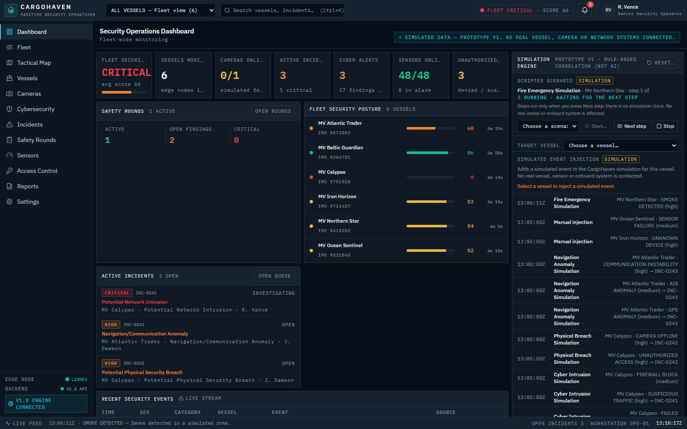
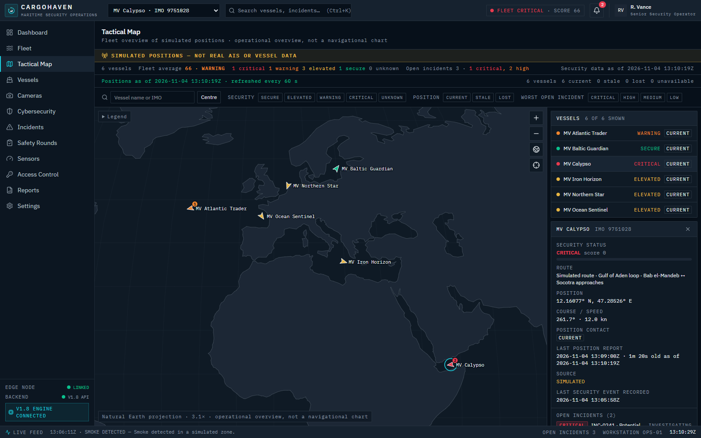
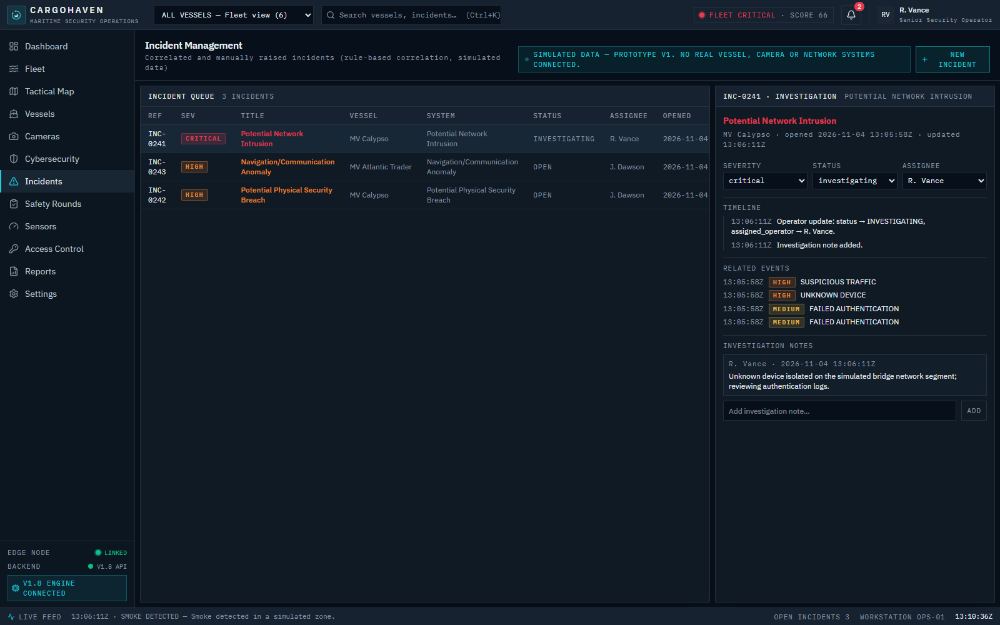
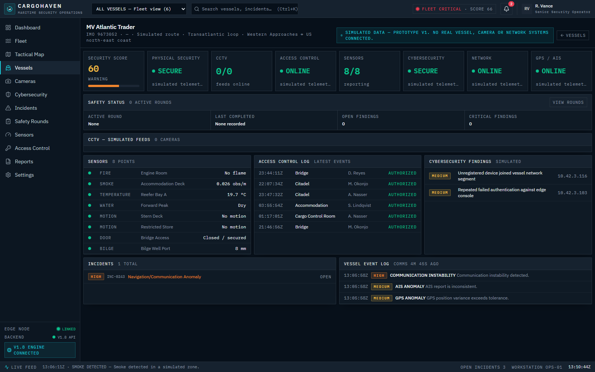
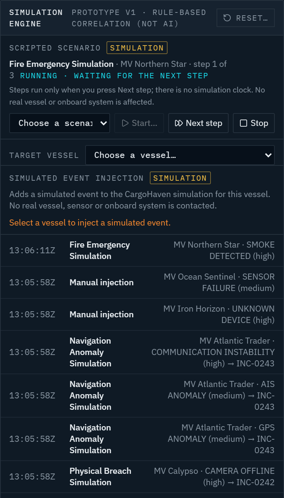

# CargoHaven

**Maritime Security Operations, Unified.**

CargoHaven is a maritime security operations platform for commercial shipping companies, fleet operators and maritime security teams. It is designed to connect vessel monitoring, physical security, cybersecurity and operational intelligence in one operator-facing application, so a security team can move from the fleet picture to a single vessel's situation without changing tools.

> **Project status: working prototype on simulated data.** Every vessel, position, camera, sensor, network event and security event in CargoHaven is fictional, generated by the backend's simulation engine or by frontend demo fixtures. CargoHaven does not connect to real vessels, AIS, CCTV, sensors, access-control systems, networks or other onboard infrastructure. Those integrations are **planned, not implemented**, and the software is not production-ready.

- **Repository:** <https://github.com/nonkylmik/CargoHaven>
- **Backend API version:** `1.9.0`
- **License:** proprietary (see [License](#license))

---

## Application preview

CargoHaven gives a security operations team one interface for the fleet picture, vessel positions, incidents and their investigation. The screenshots below are genuine captures of the current prototype, populated by its own simulation engine.

### Security operations dashboard



Fleet-wide security posture at a glance: each vessel's backend-calculated security score and status, incidents raised by the correlation rules, safety rounds, and the simulation console with its event log. The cyber-alert, sensor and access-control counters at the top are demo fixtures.

### Tactical map



Simulated vessel positions coloured by security status, with open-incident badges, filters for security status, position freshness and incident severity, and the selected vessel's context panel: simulated route, position, course and speed, report age and source. Positions are generated by the backend; this is not AIS data and not a navigational chart.

### Incident management and vessel monitoring

<table>
  <tr>
    <td width="50%"></td>
    <td width="50%"></td>
  </tr>
  <tr>
    <td valign="top"><strong>Incident management.</strong> Correlated incidents with severity, status and assignee. The detail pane shows the timeline, related events and investigation notes; status changes follow the backend's allowed transitions.</td>
    <td valign="top"><strong>Vessel monitoring.</strong> One vessel's security score, incidents, event log and safety status. The physical-security, sensor, access-control, cybersecurity, network and GPS/AIS panels are illustrative fixtures and are not linked to the simulated events.</td>
  </tr>
</table>

### Simulation and scenarios

<table>
  <tr>
    <td width="40%"></td>
    <td valign="top">The simulation console drives the prototype. Four deterministic scenarios (cyber intrusion, physical breach, navigation anomaly and fire emergency) advance one step at a time, and single events can be injected for a selected vessel. The log shows each simulated event and the incident it was correlated into. Nothing runs on a clock, and no vessel or onboard system is contacted.</td>
  </tr>
</table>

> **About these screenshots:** captured on 2026-11-04 from the prototype running locally (frontend at 1600×1000, backend on a scratch SQLite database) after running the built-in scenarios through the simulation API. They show one captured demo state, not a live or persistent one: the scores, incidents, timestamps and the scenario shown in progress depend on which simulation steps were run, and change as soon as the simulation is used or reset. All vessels, positions, events, incidents, operators and crew names are fictional demo data. No real vessel, AIS feed, CCTV, sensor, access-control or network system is connected.

---

## Contents

- [Application preview](#application-preview)
- [Who it is for](#who-it-is-for)
- [Capabilities](#capabilities)
- [Architecture](#architecture)
- [Frontend/backend integration](#frontendbackend-integration)
- [Security simulation and event correlation](#security-simulation-and-event-correlation)
- [Database and persistence](#database-and-persistence)
- [Development setup](#development-setup)
- [Testing and validation](#testing-and-validation)
- [Project structure](#project-structure)
- [Limitations and unverified areas](#limitations-and-unverified-areas)
- [Planned development](#planned-development)
- [Former name and legacy identifiers](#former-name-and-legacy-identifiers)
- [Development history](#development-history)
- [License](#license)

---

## Who it is for

- Commercial shipping companies and fleet operators.
- Vessel operators and their security officers.
- Maritime security professionals and security operations teams.
- Maritime IT and security teams responsible for onboard systems.

CargoHaven is a security and operational-awareness product. It is not a cargo-management, freight-forwarding or logistics system.

---

## Capabilities

Status key:

- **Implemented:** working functionality backed by the backend and its database.
- **Simulated data:** the feature works, but its input comes from the simulation engine, not from real systems.
- **Fixture:** an illustrative screen populated by frontend demo data; the backend has no equivalent endpoint yet.
- **Planned:** not built.

| Capability | Status | What exists today |
|---|---|---|
| Vessel monitoring and tactical map | Implemented · simulated data | `/map` shows backend-generated vessel positions with security status, course and speed, report time and a freshness classification (current, stale, lost) made by the backend. Filters, a vessel list and a selected-vessel context panel with its simulated route. Not AIS and not a navigational chart. |
| Security operations dashboard | Implemented · simulated data and fixtures | `/` summarises fleet security status and score, cameras online, active incidents, recent security events and safety rounds, and hosts the simulation console. Its sensor, cyber-alert and access-control figures come from fixtures. |
| Fleet and vessel views | Implemented · simulated data | `/fleet`, `/vessels` and `/vessels/$vesselId` show per-vessel security score and status, last communication, events, incidents and safety data. |
| Physical security monitoring | Partly implemented · simulated data and fixtures | Physical security events (`UNAUTHORIZED_ACCESS`, `CAMERA_OFFLINE`, `SENSOR_FAILURE`) are generated, persisted and correlated by the backend. `/cameras` lists the backend's camera records with placeholder feeds (no video). `/sensors` and `/access-control` are fixtures. |
| Cybersecurity event monitoring | Partly implemented · simulated data and fixtures | Cyber events (`UNKNOWN_DEVICE`, `FAILED_AUTHENTICATION`, `SUSPICIOUS_TRAFFIC`, `FIREWALL_BLOCK`) are simulated, persisted, correlated and shown in event and incident views. `/cybersecurity` is a fixture. Nothing scans or monitors a real network. |
| Incident management | Implemented | Incidents created by correlation rules or by operators; validated status transitions (new, investigating, contained, resolved, false positive) and reopening with a reason; notes, activity history, related events and event acknowledgement (`/incidents`). |
| Safety rounds | Implemented · demo data | Templates, round lifecycle (start, complete, cancel), checkpoint results and findings; failed checkpoints create security events (`/safety-rounds`). |
| Operator actions | Implemented · simulated data | From the map's vessel panel: inject a simulated event for the vessel (with a confirmation that names the simulation), start an investigation on an open incident, view the vessel's camera records and its latest simulation-log entries. |
| Simulation engine and scenario controls | Implemented | Four deterministic scenarios, manual event injection, and start, next step, pause, resume, stop and reset. The dashboard console warns before replacing a running scenario and shows the simulation log. |
| Risk scoring | Implemented | A bounded 0–100 score per vessel, classified by the backend as `SECURE`, `ELEVATED`, `WARNING` or `CRITICAL`. |
| Historical event data | Implemented | Security events are persisted. `GET /api/security-events` supports filtering and paging (`limit`, `offset`, `severity`, `event_type`, `status`, `scenario`, `vessel_id`, `start`, `end`); the simulation log is available at `GET /api/v1/simulation/log`. |
| Reporting | Implemented · simulated data and fixtures | `/reports` summarises the current simulated session and persisted safety rounds; sensor figures come from fixtures. |
| API and real-time communication | Implemented | REST API under `/api/v1` (plus legacy unversioned routes), OpenAPI docs at `/docs`, and a WebSocket at `/ws/security` that broadcasts state changes after they are committed. |
| Authentication | Implemented · optional | A single demo user with an HMAC-signed session cookie, off by default (`AUTH_REQUIRED`). |
| Real vessel, AIS, CCTV, sensor, access-control and network integrations | Planned | Not built. See [Planned development](#planned-development). |

Sensor, access-control and cybersecurity-alert telemetry are frontend fixtures (`src/lib/seashield/data.ts`) because the backend has no equivalent endpoints yet.

**Frontend views** (TanStack file routes in `src/routes/`):

| View | Route | Data source |
|---|---|---|
| Dashboard | `/` | Backend data merged with visual fixtures |
| Tactical map | `/map` | Backend vessel positions, security status and incidents |
| Fleet overview | `/fleet` | Backend vessels |
| Vessels and vessel detail | `/vessels`, `/vessels/$vesselId` | Backend vessels, events, incidents, safety data; sensor/access/cyber panels from fixtures |
| CCTV monitoring (simulated feeds) | `/cameras` | Backend camera records; no real video |
| Incidents | `/incidents` | Backend |
| Safety rounds | `/safety-rounds` | Backend |
| Security reporting | `/reports` | Current simulated session and persisted safety rounds |
| Sensors | `/sensors` | Frontend fixtures |
| Access control | `/access-control` | Frontend fixtures |
| Cybersecurity | `/cybersecurity` | Frontend fixtures |
| Settings and connection status | `/settings` | Backend health |

---

## Architecture

```text
            React / TypeScript frontend
       TanStack Start + Router · Tailwind CSS
     src/lib/seashield/backend.ts (REST + WebSocket)
                         │
                         │  HTTP (JSON)  /  WebSocket /ws/security
                         ▼
               FastAPI backend (backend/app/main.py)
                         │
     ┌───────────────────┼────────────────────┐
     ▼                   ▼                    ▼
 Simulation          Security engine       Persistence
 engine              (correlation,         SQLAlchemy 2 + Alembic
 (scenarios, event   risk scoring,         SQLite (default)
 library, positions) incidents)
```

| Layer | Technology |
|---|---|
| Frontend | React 19, TypeScript (strict), TanStack Start / Router / Query, Tailwind CSS 4, shadcn/ui components |
| Frontend build | Vite 8 with an explicit `vite.config.ts`; `npm run build` produces a Nitro server build (Cloudflare module preset) in `.output/` |
| Backend and API | Python, FastAPI, Uvicorn, Pydantic v2 |
| Real-time communication | FastAPI WebSocket endpoint `/ws/security` with an in-memory broadcast manager (`backend/websocket_manager.py`) |
| Simulation engine | `backend/simulation/`: event library, deterministic scenarios, simulated vessel positions |
| Security engine | `backend/security_engine/`: correlation rules, risk scoring, incident handling |
| Database | SQLAlchemy 2, Alembic migrations, SQLite (default); PostgreSQL support exists in code but is unverified |
| Testing | `node --test` (+ `jsdom`) for frontend units; pytest for the backend |
| Tooling | npm (`package-lock.json`), ESLint + Prettier, Docker Compose (optional backend dev environment) |
| CI | GitHub Actions (`.github/workflows/ci.yml`) |

**Deployment infrastructure.** There is no production deployment. What exists:

- A **development** Docker image and Compose file for the backend (`backend/Dockerfile`, `compose.yaml`).
- A frontend build targeting Nitro's Cloudflare module preset. No hosting, domain or deployment pipeline is configured.
- A standalone marketing landing page in `marketing-site/` (static HTML, CSS and JavaScript), which is not published.

---

## Frontend/backend integration

The UI reaches the backend only through `src/lib/seashield/services.ts` and `src/lib/seashield/backend.ts`.

- **Base URL:** `VITE_API_URL`, defaulting to `http://localhost:8000`. It is read at build time (`import.meta.env`), so changing it requires restarting `npm run dev` or rebuilding.
- **REST:** the client loads vessels, positions, cameras, security events, incidents, safety rounds, findings and the simulation log from `/api/v1/...` and `/api/security-events`, and calls `/health` to show the backend status.
- **Writes:** acknowledging events and changing or annotating incidents apply locally at once; if the backend rejects the change or cannot be reached, the local change is undone, the state is re-read from the backend, and an error notification names the action and the backend's reason. Creating an incident waits for the backend (which assigns the ID) and keeps the form open on failure. A refresh that fails after a successful write marks the backend as degraded but does not report the write as failed.
- **WebSocket:** the client connects to `/ws/security` on the same host as `VITE_API_URL`, and the scheme follows that URL: `http://` becomes `ws://`, and `https://` becomes `wss://`. With the default `http://localhost:8000`, the connection is unencrypted (`ws://localhost:8000/ws/security`). The backend does not terminate TLS itself: Uvicorn serves plain HTTP and WebSocket, so a `wss://` connection would need a TLS-terminating proxy, which this project does not include. Any message from the server triggers a debounced refresh of backend data. If the connection drops, the UI marks the backend as degraded and reconnects with exponential backoff.
- **Server messages** include `security_event`, `security_event_created`, `security_event_deleted`, `incident_created`, `incident_updated`, `security_score_changed`, `vessel_status_changed`, `simulation_status`, `notification`, `event_acknowledged` and the `safety_round_*` / `safety_checkpoint_updated` / `safety_finding_*` types.
- **CORS:** the backend allows `http(s)://localhost` and `http(s)://127.0.0.1` origins on any port, with credentials.

Many routes exist under both a legacy path (e.g. `/vessels`, `/simulation/tick`) and `/api/v1/...`. The interactive API reference is at `http://localhost:8000/docs` while the backend runs. More backend detail is in [`backend/README.md`](backend/README.md).

---

## Security simulation and event correlation

All events are fictional labels. For example, `FAILED_AUTHENTICATION` does not attempt authentication, and `UNKNOWN_DEVICE` does not scan a network.

**Event library** (`backend/simulation/event_generator.py`):

| Category | Event types |
|---|---|
| Cyber | `UNKNOWN_DEVICE`, `FAILED_AUTHENTICATION`, `SUSPICIOUS_TRAFFIC`, `FIREWALL_BLOCK` |
| Physical | `UNAUTHORIZED_ACCESS`, `CAMERA_OFFLINE`, `SENSOR_FAILURE` |
| Vessel | `GPS_ANOMALY`, `AIS_ANOMALY`, `COMMUNICATION_INSTABILITY` |
| Environmental | `SMOKE_DETECTED`, `FIRE_ALARM`, `TEMPERATURE_HIGH` |

**Scenarios** (`backend/simulation/scenario_manager.py`), listed by `GET /api/v1/simulation/scenarios` and stepped with `POST /api/v1/simulation/next`:
`cyber-intrusion`, `physical-breach`, `navigation-anomaly`, `fire-emergency`.

**Manual injection:** the simulation console and the map's vessel panel trigger single events through `POST /api/v1/simulation/inject`.

**Correlation rules** (`backend/security_engine/event_correlation.py`). Each new event is checked against the rules that include its type. A rule matches when every one of its event types is present among the vessel's **unresolved** events. A match creates an incident, unless an open incident from the same rule already exists for that vessel, in which case the matching events are added to it:

| Rule | Required events | Severity |
|---|---|---|
| Potential Network Intrusion | `UNKNOWN_DEVICE`, `FAILED_AUTHENTICATION`, `SUSPICIOUS_TRAFFIC` | Critical |
| Potential Physical Security Breach | `UNAUTHORIZED_ACCESS`, `CAMERA_OFFLINE` | High |
| Navigation/Communication Anomaly | `GPS_ANOMALY`, `AIS_ANOMALY`, `COMMUNICATION_INSTABILITY` | High |
| Fire/Environmental Emergency | `SMOKE_DETECTED`, `FIRE_ALARM`, `TEMPERATURE_HIGH` | Critical |

**Risk scoring** (`backend/security_engine/risk_scoring.py`): score = vessel base score − penalties for its unresolved events − penalties for its open incidents (anything not `RESOLVED` or `FALSE_POSITIVE`), clamped to 0–100.

| Severity | Info | Low | Medium | High | Critical |
|---|---|---|---|---|---|
| Event penalty | 0 | 2 | 5 | 10 | 20 |
| Incident penalty | 0 | 4 | 8 | 15 | 25 |

Vessel security status is classified by the backend only (`backend/models/security_status.py`), from the score: `SECURE` 86–100, `ELEVATED` 72–85, `WARNING` 55–71, `CRITICAL` 0–54. Every API response and WebSocket message derives the status from the score, so a stale or missing stored value is never returned. The UI shows the status it receives and never classifies scores; a missing or unrecognised status is shown as unknown. Fleet status is the most severe vessel status (critical, then unknown, warning, elevated, secure); the fleet average score is coloured by the backend's classification of the average itself (`GET /api/v1/fleet/security-summary`), not by the worst vessel. Severity (info–critical) classifies individual events, incidents and safety findings and affects a vessel's status only through these penalties.

Example flow (cyber intrusion scenario):

```text
UNKNOWN_DEVICE → FAILED_AUTHENTICATION → SUSPICIOUS_TRAFFIC
        → rule "Potential Network Intrusion" matches
        → critical incident created (or updated, if one is already open), vessel score reduced
        → WebSocket broadcast → UI refreshes
```

---

## Database and persistence

- **SQLite is the current default and the only database the project has been run against.** Without `DATABASE_URL`, the backend uses `backend/seashield.db`.
- **SQLAlchemy 2** models live in `backend/db/models.py`, with data access through repositories in `backend/db/repositories/`.
- **Alembic** migrations live in `backend/alembic/versions/` (`0001`–`0006`). `alembic/env.py` uses the same `DATABASE_URL` as the application.
- **On startup** the application also runs `Base.metadata.create_all`, seeds demo safety-round data and re-syncs the in-memory simulation engine from the database.
- **Configuration:** `DATABASE_URL` and the other backend settings are read from the environment or a root `.env` file (see [backend environment variables](#backend-environment-variables)). `.env` files and `*.db` files are gitignored.
- **PostgreSQL:** support exists in code (the `psycopg` driver in `requirements.txt` and `JSONB` column variants), but it **has not been verified against a running PostgreSQL server**.

**Persistence by workflow:**

| Workflow | Database location | Lifetime |
|---|---|---|
| Host backend | `backend/seashield.db` (or `DATABASE_URL`) | Until the file is deleted |
| Docker Compose | `/data/seashield.db` in the named volume `seashield-data` | Survives `docker compose down` and rebuilds; deleted by `docker compose down -v` |
| Backend tests | Throwaway `backend/seashield_test.db` and temporary files | Removed after the test run |

The host and Docker databases are separate.

---

## Development setup

### Prerequisites

- **Git**, to clone the repository.
- **Node.js** `^22.22.2 || ^24.15.0 || >=26.0.0` (from `package.json` `engines`; `.nvmrc` selects 24) and **npm**. `package-lock.json` is the only lockfile.
- **Python** 3.12 or newer for the host backend. 3.12 is the provisional minimum and is not yet declared in config; CI tests 3.12 and 3.13.
- **Docker** with Compose (optional, for the Docker backend).

### Get the code

```bash
git clone https://github.com/nonkylmik/CargoHaven.git
cd CargoHaven
```

### 1. Backend

Run either the host backend or the Docker backend. Both use port 8000, so only one can run at a time.

#### Option A: Host (Python virtual environment)

From the `backend/` directory:

```bash
python -m venv .venv
# Windows (PowerShell):  .\.venv\Scripts\Activate.ps1
# Linux/macOS:           source .venv/bin/activate
python -m pip install -r requirements.txt
python -m alembic upgrade head
python -m uvicorn app.main:app --reload --port 8000
```

- Run `alembic upgrade head` before the first start, so the database is migration-tracked.
- Uvicorn listens on `http://127.0.0.1:8000`.
- `backend/.venv/` is gitignored.
- Startup and Alembic write to the configured database. To try the backend without touching `backend/seashield.db`, set `DATABASE_URL=sqlite:///<scratch path>.db` first.

#### Existing databases created without migrations

The backend's startup code creates any missing tables (`Base.metadata.create_all`) but does not record an Alembic version. A database created by starting the backend before ever running `alembic upgrade head` is therefore unversioned. Earlier versions of this README gave exactly that sequence. On such a database, `alembic upgrade head` fails at the first migration with `table security_events already exists`. No data is lost, but the database stays unversioned.

The recovery procedure below applies **only** to a database that was created by the **current** startup code and whose schema you have verified against a database built by `alembic upgrade head`:

1. **Back up first.** Stop the backend and copy the database file (for example `backend/seashield.db`) somewhere safe before stamping or migrating.
2. **Verify the schema.** Compare it with a reference database created by `alembic upgrade head` on a fresh, empty file (set `DATABASE_URL` to a scratch path). Matching table and column names alone is **not** sufficient. The comparison must also cover column types, nullability, primary keys, unique and foreign-key constraints, indexes, and any other schema details.
   - The known, expected differences are these: uniqueness is enforced by unique indexes instead of `UNIQUE` constraints, columns lack SQL default values, and there are two extra indexes (`ix_incidents_severity`, `ix_incidents_type`).
   - Any other difference means the procedure does not apply.
3. **Stamp, then confirm.** Run `python -m alembic stamp head`, then `python -m alembic upgrade head`. The upgrade should report nothing to apply.
4. **Check the backend.** Start it and check `GET /health`.

> **Never stamp an unknown or older schema to `head`.** Stamping only records a version; it does not change tables. If the database came from an older version of CargoHaven (including versions released as SeaShield), or if you are unsure of its origin or whether its schema matches, **stop and investigate** instead of guessing a revision. Keep the backup until the database is confirmed working.

The Docker workflow is not affected: it runs migrations before the first start on its own volume.

#### Option B: Docker Compose

From the repository root:

```bash
docker compose up --build    # build the image and start the backend
docker compose down          # stop and remove the container; data is kept
```

- The container runs `alembic upgrade head`, then Uvicorn on `0.0.0.0:8000`. Compose publishes it on `127.0.0.1:8000` only.
- SQLite is stored in the `seashield-data` volume (see [persistence](#database-and-persistence)).
- Code changes require `docker compose up --build`; there is no auto-reload.
- `.env*` and `*.db` files are excluded from the image.
- Full details are in [`backend/README.md`](backend/README.md#docker-development).

#### Backend environment variables

| Variable | Default | Purpose |
|---|---|---|
| `DATABASE_URL` | SQLite file `backend/seashield.db` (host); `compose.yaml` sets `sqlite:////data/seashield.db` | SQLAlchemy database URL |
| `AUTH_REQUIRED` | `false` | Require a session for API and WebSocket access |
| `SESSION_SECRET` | development placeholder | Required when `AUTH_REQUIRED=true`; startup fails without it |
| `DEMO_USER_EMAIL` | `operator@seashield.local` | Demo user login |
| `DEMO_USER_PASSWORD` | `seashield-demo` | Demo user password |

On the host, any of these can be set in the shell environment or in a root `.env` file; a variable set in the shell takes precedence. With Docker Compose, they come from your shell or the root `.env` that Compose reads. Details are in [`backend/README.md`](backend/README.md#configuration).

**Check that the backend is up:** `GET http://localhost:8000/health` returns `{"status":"ok","database":"connected","mode":"simulation","version":"1.9.0"}`.

### 2. Frontend

From the repository root:

```bash
npm ci        # or: npm install
npm run dev
```

- Open **http://127.0.0.1:8080** (also reachable as `http://localhost:8080`). The dev server listens only on `127.0.0.1`, and `predev` stops with an error if port 8080 is already in use.
- To use a different backend, set `VITE_API_URL` (e.g. `VITE_API_URL=http://localhost:8001`) before `npm run dev` or `npm run build`.

### 3. Marketing site (optional)

The landing page in `marketing-site/` has no dependencies and no build step. From `marketing-site/`:

```bash
npm run serve   # preview on http://127.0.0.1:5180 (MARKETING_PORT to change)
npm test        # page and form checks
```

See [`marketing-site/README.md`](marketing-site/README.md).

### Useful scripts

| Command | Purpose |
|---|---|
| `npm run dev` | Development server on `127.0.0.1:8080` |
| `npm run build` | Production build into `.output/` (does not type-check) |
| `npm run preview` | Preview the production build |
| `npm run test:unit` | Frontend unit tests (`node --test "src/**/*.test.mjs"`) |
| `npm run test:scripts` | Tests for the dev-port check |
| `npx tsc --noEmit` | Type-check |
| `npm run lint` | ESLint with Prettier as a rule |

Don't run `npm run format` unless you intend to reformat many files.

---

## Testing and validation

### How to run

```bash
npm run test:unit
npm run test:scripts
npm run build
npx tsc --noEmit
npx eslint . --rule "prettier/prettier: [error, {endOfLine: auto}]"

# Backend, from backend/ (host)
python -m pytest

# Backend, in the Docker image
docker compose run --rm --no-deps backend python -m pytest

# Marketing site, from marketing-site/
npm test
```

The ESLint command relaxes only Prettier's line-ending check. On Windows with `core.autocrlf=true`, plain `npm run lint` reports `Delete ␍` on almost every line, which is checkout noise rather than a code problem.

### Continuous integration

GitHub Actions (`.github/workflows/ci.yml`) runs on pull requests and on pushes to `main` and `feature/**`:

- **Frontend:** `npm ci`, script tests, unit tests, `tsc --noEmit`, `npm run lint` and `npm run build`, on the Node version in `.nvmrc`.
- **Backend:** `pytest` on Python 3.12 and 3.13, then `alembic upgrade head` against a fresh SQLite database, and a check that no repository database was written.

### Latest local results

Recorded on 2026-11-04 on Windows 11 (Node 24.20.0, npm 11.19.0, Python 3.13.15). Re-run the checks before relying on them for a later commit.

| Check | Result |
|---|---|
| `npm run test:unit` | 133 passed |
| `npm run test:scripts` | 7 passed |
| `npx tsc --noEmit` | No errors |
| ESLint (with the line-ending override) | 0 errors, 13 warnings (pre-existing `react-hooks/exhaustive-deps` and similar) |
| `npm run build` | Succeeded |
| Backend `python -m pytest` | 274 passed |
| Marketing site `npm test` | 26 passed |

**Windows note:** after `npm run build` or `npm run dev`, Git may show `src/routeTree.gen.ts` as modified. The generator writes LF line endings over a CRLF checkout; the content is unchanged, so don't commit it.

---

## Project structure

```text
CargoHaven/
├── backend/
│   ├── app/main.py              # FastAPI app: routes, /ws/security, startup
│   ├── auth.py                  # optional demo authentication (AUTH_REQUIRED)
│   ├── websocket_manager.py     # in-memory WebSocket broadcast
│   ├── db/                      # SQLAlchemy engine, models, repositories
│   ├── alembic/                 # migrations (versions/0001–0006)
│   ├── models/, schemas/        # Pydantic contracts
│   ├── simulation/              # event library, scenarios, simulated positions, simulation engine
│   ├── security_engine/         # correlation rules, risk scoring, incidents
│   ├── tests/                   # pytest suite
│   ├── Dockerfile, .dockerignore
│   ├── requirements.txt
│   └── README.md
├── src/
│   ├── routes/                  # TanStack file routes (one per view)
│   ├── components/seashield/    # application components (folder keeps its former name)
│   ├── components/ui/           # shadcn/ui components (generated)
│   ├── lib/seashield/           # store, services, backend client, fixtures, unit tests
│   └── routeTree.gen.ts         # generated route tree (do not edit)
├── marketing-site/              # standalone landing page (not published)
├── scripts/                     # assert-dev-port.mjs (+ test)
├── public/                      # favicons, robots.txt
├── .github/workflows/ci.yml     # GitHub Actions CI
├── compose.yaml                 # Docker Compose backend (development)
├── vite.config.ts
├── package.json, package-lock.json, .nvmrc
├── CLAUDE.md, AGENTS.md         # contributor and AI-agent guidance
├── LICENSE
└── README.md
```

The repository also contains `_patch_probe/`, a set of historical patch files that nothing references.

---

## Limitations and unverified areas

- **No real integrations:** no vessel, AIS, CCTV, sensor, access-control or network connections, and no vessel control. All data is simulated or demo data.
- **No real detection:** the correlation engine demonstrates rule-based logic on fictional events; it is not intrusion detection or production monitoring.
- **Fixture screens:** sensors, access control and the cybersecurity view use frontend demo data, not backend data.
- **PostgreSQL** has not been verified against a running server.
- **`AUTH_REQUIRED=true`** and its session-cookie behavior have not been verified end-to-end. With the frontend on `127.0.0.1:8080` and the API on `localhost:8000`, the two count as different sites, which may affect the `SameSite=Lax` cookie.
- **Docker** has been tested on Windows 11 with Docker Desktop only, not on Ubuntu.
- **No production deployment or hardening:** the Docker setup is a development environment only, and the marketing site is not published.

---

## Planned development

The following are **goals, not implemented functionality**:

- Real vessel and edge-server integrations: AIS position sources, CCTV, onboard sensors and access control.
- Connecting findings from onboard network and cybersecurity tools.
- PostgreSQL persistence validated against a running server (driver and schema support already exist in code).
- A desktop client communicating with a central backend and, later, vessel/edge servers.
- Advanced event correlation and assisted detection.
- Expanded fleet analytics, compliance and reporting.
- Production-grade security controls, hardening and deployment.

```text
        Operator client
              │  API / WebSocket
              ▼
   Central backend (Python / FastAPI)
        │                │
        ▼                ▼
  Security engine     Database
        │
        ▼
  Vessel / edge server
   │      │        │
  CCTV  Sensors  Network systems
```

---

## Former name and legacy identifiers

CargoHaven was developed under the name **SeaShield** until November 2026, and the repository was previously `nonkylmik/SeaShield-V1.8-V2` (GitHub redirects the old URL). Some technical identifiers keep the former name because renaming them would break compatibility. They are not product branding:

| Identifier | Why it is kept |
|---|---|
| `src/lib/seashield/`, `src/components/seashield/` and code names such as `useSeaShield` | Internal import paths; renaming them would touch most of the frontend for no user-visible change |
| `backend/seashield.db`, `seashield_test.db` | Existing local databases and test configuration |
| `seashield-data` Docker volume and `seashield` container user | Renaming the volume would orphan existing Docker data |
| `seashield_session` cookie | Renaming it would sign out every existing session |
| Demo login defaults (`operator@seashield.local`, `seashield-demo`) | Documented credentials used by setups and tests |
| Migration test fixtures and their comments | Records of databases created by earlier versions |

---

## Development history

CargoHaven is an independent project built through iterative prototyping. The V2 interface was originally developed partly with [Lovable](https://lovable.dev); the project no longer depends on Lovable tooling.

- **V3 foundation:** Lovable independence (explicit `vite.config.ts`), a strict dev port with a `predev` check, a declared Node.js range, a Docker development backend, migration integrity checks, and fixes for `/cameras` hydration and the vessel-detail render loop and loading state.
- **V4:** the tactical map with backend-owned simulated positions and freshness, the vessel context panel and operator actions, canonical security status bands, incident transitions and reopening, scenario controls and the simulation log, write-failure reporting, and GitHub Actions CI.
- **November 2026:** renamed from SeaShield to CargoHaven.

---

## License

CargoHaven is proprietary software. Copyright 2026 nonkylmik. All rights reserved. See [LICENSE](LICENSE) for the full terms.
